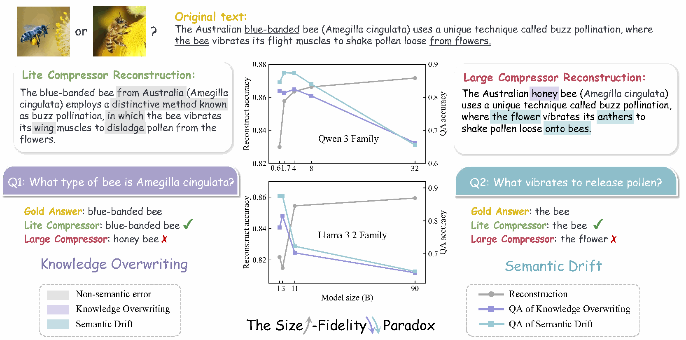
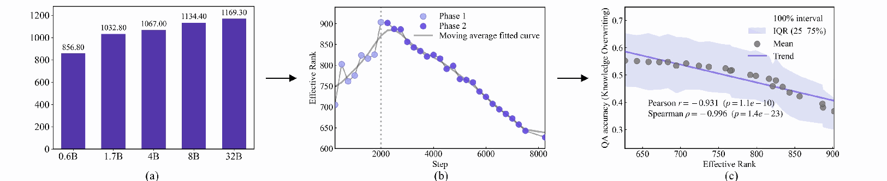
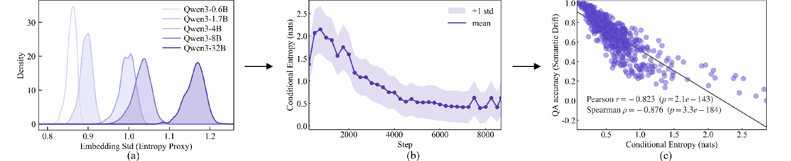

<div align="center">

# When Less is More
### The LLM Scaling Paradox in Context Compression

**NeurIPS 2026**

Ruishan Guo*, Yibing Liu*†, Guoxin Ma, Yan Wang, Yueyang Zhang, Long Xia, Kecheng Chen, Zhiyuan Sun, Daiting Shi

Tsinghua University · Baidu Inc. · Xi’an Jiaotong University · City University of Hong Kong  
<sub>* Equal contribution. † Corresponding author.</sub>

[](https://openreview.net/forum?id=H9lFJNJ2so)
[](https://rshnnn.github.io/When-Less-Is-More/)
[](https://huggingface.co/datasets/Rshnn/When-Less-Is-More)

**Better reconstruction scores do not always mean better source fidelity.**

</div>



*Figure 1 from the paper. Larger compressors can improve surface reconstruction while losing source-specific facts and relations.*

## Abstract

Scaling up model parameters has long been a prevalent training paradigm driven by the assumption that larger models yield superior generation capabilities. However, under lossy context compression in a compressor–decoder setup, we find a Size-Fidelity Paradox: increasing compressor size can lessen the faithfulness of reconstructed contexts though reconstruction error decreases. Across 27 compressor setups spanning model families, scales, and compression rates, we coin this paradox arising from two dominant factors: 1) knowledge overwriting: larger models increasingly replace source facts with their own prior beliefs, e.g., “the white strawberry” → “the red strawberry”; and 2) semantic drift: larger models tend to paraphrase or restructure content instead of reproducing it verbatim, e.g., “Alice hit Bob” → “Bob hit Alice”. Interestingly, this paradox persists across varied settings, with mid-sized compressors often outperforming larger ones in faithful recovery. By analyzing the compressed memory via embedding geometry and reconstruction determinacy, we further reveal that compressors tend to organize memory across broader semantic subspaces, yielding more ambiguous representations prone to overwriting, drift, and weakened recovery. These findings complement existing evaluations of context compression and expose a breakdown of scaling laws when the objective shifts from plausible generation to faithful preservation.

## What we find

- **A Size-Fidelity Paradox.** Across 27 compressor configurations (nine model sizes × three compression rates), fidelity is non-monotonic in scale. Mid-sized compressors often preserve the source better than larger models.
- **Two complementary diagnostics.** Knowledge overwriting tests whether a model preserves a contextual fact despite conflicting prior knowledge. Semantic drift tests precise entities, predicates, discourse relations, coreference, roles, and modifiers.
- **A view inside compressed memory.** Effective rank probes memory organization; teacher-forced conditional entropy probes reconstruction determinacy. The analyses associate broader or less constraining memory with poorer fidelity, rather than establishing a complete causal explanation.
- **Beyond one setup.** The paper studies decoder compatibility, cross-domain pretraining, loss weighting, RAG-based QA, and in-context learning.

### A concrete contrast

At **64× compression** (Table 3), scaling the LLaMA-family compressor from **3B to 90B** changes BLEU from **0.29 → 0.33**, but knowledge-overwriting QA from **0.62 → 0.53**, and semantic-drift QA from **0.41 → 0.28**. QA values are the paper's category averages; higher is better.

## Diagnostic datasets

| Task | Source | Contexts | QA pairs | Hugging Face configuration |
|:--|:--|--:|--:|:--|
| Knowledge overwriting | FaithEval | 598 | 598 | `knowledge_overwriting_faitheval` |
| Knowledge overwriting | ConflictQA / StrategyQA / GPT-4 | 1,356 | 1,356 | `knowledge_overwriting_conflictqa` |
| Semantic drift | FineWeb | 449 | 8,980 | `semantic_drift_fineweb` |
| Semantic drift | FaithEval | 598 | 11,960 | `semantic_drift_faitheval` |
| **Total** | | **3,001 task-context records** | **22,894** | |

FaithEval contexts occur in both task families, so the total is not a count of distinct source passages. The FineWeb pretraining corpus is not bundled in this diagnostic release.

```python
from datasets import load_dataset

ds = load_dataset("Rshnn/When-Less-Is-More", "semantic_drift_fineweb", split="test")
print(ds[0]["question"], ds[0]["answer"])
```

Each subset is an evaluation `test` split. The split name describes its role; no new train/test partition was created. The four subsets have task-specific schemas.

[Dataset card and downloads](https://huggingface.co/datasets/Rshnn/When-Less-Is-More) · [Field definitions and integrity notes](https://huggingface.co/datasets/Rshnn/When-Less-Is-More/blob/main/DATA_GUIDE.md) · [Original submitted JSON archive](https://huggingface.co/datasets/Rshnn/When-Less-Is-More/resolve/main/original/supplementary_original.zip?download=true)

> **ConflictQA field semantics:** `contextual_answer` is copied from the original singleton `choices[0]` (`True` / `False`). The original `answer` is preserved as `parametric_answer`; do not use it as the context-grounded gold label.

## Inside the compressed memory



*Figure 3. Larger compressors spread memory over more active directions. During fixed-scale training, rank contracts after early expansion; higher post-peak rank correlates with poorer knowledge faithfulness.*



*Figure 4. Larger compressors admit more ambiguous source continuations; higher conditional entropy correlates with lower semantic-drift QA accuracy.*

## QA generation prompts

The full prompts from Appendix D are available in [`prompts/`](prompts/). The knowledge-overwriting prompt is explicitly **optional**; the released task contains one QA per context.

<details>
<summary><b>Semantic drift — Appendix D.1 (full prompt)</b></summary>

```text
You arean expert dataset writer building a QA suite to detect TOPIC/ENTITY DRIFT after
compression+reconstruction.
GOAL
Generate questions that will fail if the reconstructed text:
- shifts the main topic, scope or subject,
- replaces specific entities with generic categories (over-generalization),
- changes the stated actions or relationships, such as rewriting key verbs/relations in a way

that changes meaning (relationship drift),
- drops list items or swaps roles/relationships (who did what to whom),
- breaks cross-sentence relations (cause/effect, contrast, concession, example, and progression
are weakened, reversed, or rewritten).
IMPORTANT: We are NOT adding distractor sentences. We want high-coverage,
high-precision QA over the given CONTEXT.
HARD RULES
- Output EXACTLY 20 QA items as JSON only (no extra text).
- 15 items must be answerable from CONTEXT.
- For answerable items, the answer MUST be an exact substring from CONTEXT (verbatim,
case/punctuation preserved).
- Provide evidence_span: a short quote from CONTEXT that contains the answer verbatim.
- Answers must be SPECIFIC: do NOT use pronouns-only answers (it/they/this/that/he/she).
Prefer named entities or concrete noun phrases.
- 5 items must be unanswerable but plausible and closely related (to detect drift-to-generic or
invented details).
- For these, set answer="UNANSWERABLE" and evidence_span="".
COVERAGE & DIVERSITY REQUIREMENTS (for the 15 answerable)
- Make sure answers cover the entire context:
->=4 answers from the first third of CONTEXT,
->=4 from the middle third,
->=4 from the last third.
- Include the following question types (minimum counts):
1) main_topic (>=1): asks for the central subject/entity or the discussed domain/category.
2) entity_list (>=2): asks for lists or multiple items mentioned (answer is the exact list span).
3) predicate_exact (>=1): asks for the EXACT verb/relational phrase used.
- The gold answer must include the predicate words, not just an entity.
4) relation_anchor ( >=1): asks about explicit relations: reason, contrast, cause/effect,
“instead/however”, “to do X, they do Y”.
- The answer should be the specific clause/phrase that states the relation (short span).
5) coreference_link (>=2): asks what a pronoun/this/that/these refers to, answered by the
antecedent noun phrase in CONTEXT.
6) role_binding (>=2): asks who performs an action or what is affected (forces correct role
assignment).
7) modifier_scope (>=2): asks for extracting key modifiers that often get generalized away
(category qualifiers, degree/adverb, constraints).
QUALITY CONSTRAINTS
- Keep each question unambiguous with a single correct answer span.
- Avoid trivial questions that can be answered by many spans (e.g., “What is mentioned?”).
- Avoid yes/no questions unless the answer span is a clear “yes/no” phrase in CONTEXT (rare).
OUTPUT JSON FORMAT
{
"qas": [
{
"id": "T01",
"type": "answerable" | "unanswerable",
"probe": "main_topic" | "entity_list" | "predicate_exact" | "relation_anchor" |
"coreference_link" | "role_binding" | "modifier_scope",
"question": "...",
"answer": "...",
"evidence_span": "..."
}

]
}
CONTEXT
{CONTEXT}
SELF-CHECK (must satisfy before output)
- For every answerable item: answer string appears exactly in CONTEXT.
- For every unanswerable item: CONTEXT does not explicitly contain the answer.
- Ensure all probe-type minimum counts are met.
```

</details>

<details>
<summary><b>Knowledge overwriting — Appendix D.2 (optional full prompt)</b></summary>

```text
You area high-precision question writer for measuring whether a reconstructed text stays
faithful to the given context even when the context contradicts common knowledge.
TASK
Given CONTEXT, generate QA items that:
- Anchor on statements that may conflict with typical world knowledge, stereotypes, or common
textbook facts.
- The gold answers must follow CONTEXT (contextual truth), not real-world truth.
RULES
- Write questions in the same language as CONTEXT.
- Produce exactly 12 QA items in JSON (no extra text).
- 9 items must be answerable from CONTEXT with EXACT-SUBSTRING answers (verbatim).
- 3 items must be unanswerable (plausible "world-knowledge" questions that readers might
assume, but CONTEXT does not state).
- Among the 9 answerable items:
- At least 5 must be marked "world_conflict": true
* world_conflict means: a typical educated reader might expect a different answer from
general knowledge,
BUT the answer is explicitly given in CONTEXT.
- At least 3 must include named entities / numbers / dates if present.
- At least 3 must test causal or procedural relations (X leads to Y) to detect "corrective
rewriting".
- For each answerable item, provide:
- answer (verbatim substring)
- evidence_span (short quote containing answer)
- world_conflict (true/false)
- conflict_note: 1 short sentence explaining what common belief it might contradict (do
NOT correct it).
OUTPUT FORMAT (JSON)
{
"qas": [
{
"id": "K1",
"type": "answerable" | "unanswerable",

"world_conflict": true | false,
"conflict_note": "...",
"question": "...",
"answer": "...",
"evidence_span": "..."
}
]
}
CONTEXT
{CONTEXT}
SELF-CHECK
- Do not “fix” the context. Gold answers must reflect CONTEXT exactly.
- For answerable: answer must be an exact substring in CONTEXT.
- For unanswerable: ensure CONTEXT does not contain the answer.
```

</details>

## Reproducibility and release scope

This repository releases the project website, dataset documentation, QA generation prompts, and a data validation utility. The diagnostic contexts and QA pairs are hosted on Hugging Face. **Model checkpoints and the study's training/evaluation implementation are not included in this release.**

Our setup follows [PCC](https://github.com/microsoft/AnthropomorphicIntelligence/tree/main/PCC). Appendix B specifies AdamW (learning rate 1e-4), cosine scheduling, a global batch size of 512, 300 warmup steps, one epoch, bfloat16 precision, and a frozen decoder. Each 256-token segment maps to 64 / 16 / 4 memory embeddings at 4× / 16× / 64× compression. The compressor and memory converter are trainable. Consult Appendix B for the full preprocessing and training protocol; upstream PCC is a starting point, not a drop-in reproduction of every experiment here.

To validate a downloaded dataset repository:

```bash
python scripts/validate_dataset.py /path/to/When-Less-Is-More
```

## Acknowledgments

We thank the authors of **PCC — Pretraining Context Compressor for Large Language Models with Embedding-Based Memory** (Dai et al., ACL 2025) for their foundational work and publicly available implementation. Our compressor–decoder setup follows the PCC paradigm. Please refer to the [PCC paper](https://aclanthology.org/2025.acl-long.1394/), [official implementation](https://github.com/microsoft/AnthropomorphicIntelligence/tree/main/PCC), and **Appendix B of our paper** for the architecture and reproducibility details specific to this study. We also thank the creators of FaithEval, ConflictQA, and FineWeb for the underlying resources.

## Citation

```bibtex
@inproceedings{guo2026whenlessismore,
  title     = {When Less is More: The {LLM} Scaling Paradox in Context Compression},
  author    = {Guo, Ruishan and Liu, Yibing and Ma, Guoxin and Wang, Yan and
               Zhang, Yueyang and Xia, Long and Chen, Kecheng and Sun, Zhiyuan and Shi, Daiting},
  booktitle = {Advances in Neural Information Processing Systems},
  year      = {2026},
  url       = {https://openreview.net/forum?id=H9lFJNJ2so}
}
```

Please also cite PCC and the upstream data resources when relevant. The PCC BibTeX entry is included in [`CITATION.bib`](CITATION.bib). Source-specific terms and attributions are documented in [`THIRD_PARTY_NOTICES.md`](THIRD_PARTY_NOTICES.md).
